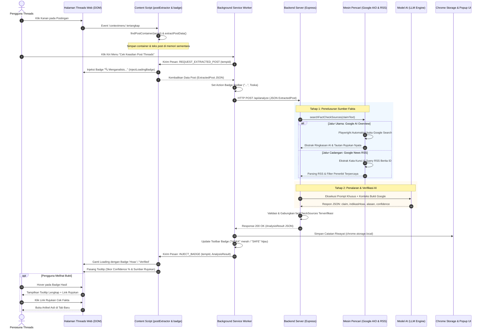
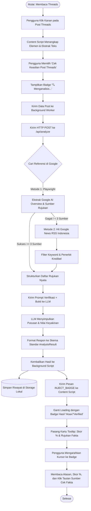
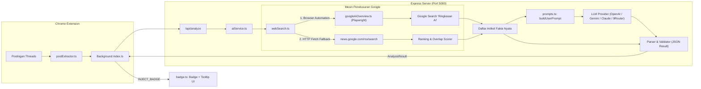

# DOKUMENTASI LENGKAP ALUR KERJA SISTEM THREADIBILITY
## Deteksi Hoaks dan Verifikasi Kredibilitas Konten Teks Meta Threads Berbasis Chrome Extension dan Multi-Model AI

> **Catatan Akademik**: Dokumen ini disusun secara terstruktur dan komprehensif untuk kebutuhan penulisan Laporan Skripsi / Tugas Akhir (khususnya Bab III Metodologi Penelitian / Perancangan Sistem dan Bab IV Implementasi & Pengujian).

---

## DAFTAR ISI
1. [Ringkasan Eksekutif Sistem](#1-ringkasan-eksekutif-sistem)
2. [Arsitektur Global & Komponen Utama](#2-arsitektur-global--komponen-utama)
3. [Alur Interaksi Pengguna (User Journey)](#3-alur-interaksi-pengguna-user-journey)
4. [Diagram Alur Sistem (Mermaid Diagrams)](#4-diagram-alur-sistem-mermaid-diagrams)
   - [4.1 Sequence Diagram End-to-End](#41-sequence-diagram-end-to-end)
   - [4.2 Activity Diagram (Alur Pengguna & Sistem)](#42-activity-diagram-alur-pengguna--sistem)
   - [4.3 Architecture & Data Flow Diagram (Google Search & AI)](#43-architecture--data-flow-diagram-google-search--ai)
5. [Rincian Alur Teknis Tahap demi Tahap](#5-rincian-alur-teknis-tahap-demi-tahap)
   - [Tahap 1: Deteksi Target & Ekstraksi DOM Threads](#tahap-1-deteksi-target--ekstraksi-dom-threads)
   - [Tahap 2: Pemicuan Context Menu & Injeksi Status Loading](#tahap-2-pemicuan-context-menu--injeksi-status-loading)
   - [Tahap 3: Komunikasi Content Script ke Background Service Worker](#tahap-3-komunikasi-content-script-ke-background-service-worker)
   - [Tahap 4: Permintaan REST API ke Backend Express](#tahap-4-permintaan-rest-api-ke-backend-express)
   - [Tahap 5: Mekanisme Penelusuran Sumber Rujukan Nyata (Hit Google)](#tahap-5-mekanisme-penelusuran-sumber-rujukan-nyata-hit-google)
   - [Tahap 6: Inferensi AI, Formulasi Prompt, & Perhitungan Skor Confidence](#tahap-6-inferensi-ai-formulasi-prompt--perhitungan-skor-confidence)
   - [Tahap 7: Pengembalian Respon & Injeksi Badge Hasil di Halaman Web](#tahap-7-pengembalian-respon--injeksi-badge-hasil-di-halaman-web)
   - [Tahap 8: Visualisasi Tooltip Interaktif & Tampilan Sumber Rujukan](#tahap-8-visualisasi-tooltip-interaktif--tampilan-sumber-rujukan)
   - [Tahap 9: Penyimpanan Riwayat & Dashboard Popup](#tahap-9-penyimpanan-riwayat--dashboard-popup)
6. [Struktur Kontrak Data (Payload JSON)](#6-struktur-kontrak-data-payload-json)
7. [Kesimpulan & Keunggulan Arsitektur](#7-kesimpulan--keunggulan-arsitektur)

---

## 1. Ringkasan Eksekutif Sistem

**Threadibility** adalah sistem verifikasi informasi dan deteksi disinformasi pada platform Meta Threads (`threads.net` / `threads.com`). Sistem ini mengintegrasikan ekstensi peramban Google Chrome berbasis **Manifest V3** dengan backend server **Node.js (Express + TypeScript)** yang didukung oleh **Model Bahasa Besar (LLM)** serta mesin pencarian referensi berita dan cek fakta riil dari Google.

Melalui sistem ini, pengguna dapat memverifikasi klaim pada sebuah postingan hanya dengan **klik kanan** pada postingan tersebut lalu memilih menu **"Cek Keaslian Post Threads"**. Sistem secara otomatis:
1. Mengekstrak teks, pembuat konten (*author username*), tautan unik, dan waktu postingan.
2. Menampilkan indikator proses langsung di sebelah nama pengguna (`🔍 Menganalisis...`).
3. Mengirimkan data ke backend untuk mencari artikel klarifikasi faktual di Google (*Google AI Overview* dan *Google News RSS*).
4. Menganalisis kesesuaian klaim menggunakan LLM dengan *prompt engineering* berbasis penalaran hukum dan bukti cek fakta.
5. Menyajikan putusan akhir berupa badge **`Verified` (Hijau)** atau **`Hoax` (Merah muda)**, disertai **skor keyakinan (Confidence Rate dalam bentuk %)** dan **daftar tautan artikel rujukan cek fakta terpercaya** yang dapat diklik langsung.

---

## 2. Arsitektur Global & Komponen Utama

Sistem Threadibility terbagi menjadi 3 subsistem utama:

```
┌─────────────────────────────────────────────────────────────────────────────────┐
│                           1. CLIENT / CHROME EXTENSION                          │
│                                                                                 │
│   ┌──────────────────────────┐             ┌────────────────────────────────┐   │
│   │   Content Script         │             │  Background Service Worker     │   │
│   │   - postExtractor.ts     │ ◄─────────► │  - index.ts                    │   │
│   │   - badge.ts & badge.css │   Chrome    │  - chrome.contextMenus         │   │
│   │   - index.ts             │   Runtime   │  - chrome.storage.local        │   │
│   └──────────────────────────┘  Messaging  │  - chrome.action (Badge Icon)  │   │
│                                            └──────────────┬─────────────────┘   │
│   ┌──────────────────────────┐                            │                     │
│   │   Popup UI (React 18)    │                            │                     │
│   │   - Dashboard Agregat    │ ◄──────────────────────────┘                     │
│   │   - History & Rujukan    │       HTTP POST (Fetch API JSON)                 │
└───┴──────────────────────────┴────────────────────────────┼─────────────────────┘
                                                            ▼
┌─────────────────────────────────────────────────────────────────────────────────┐
│                           2. BACKEND SERVER (EXPRESS TS)                        │
│                                                                                 │
│   ┌─────────────────────────────────────────────────────────────────────────┐   │
│   │  Router & Controller: server/src/index.ts (POST /api/analyze)           │   │
│   └────────────────────────────────────┬────────────────────────────────────┘   │
│                                        │                                        │
│               ┌────────────────────────┴────────────────────────┐               │
│               ▼                                                 ▼               │
│   ┌───────────────────────────────┐               ┌─────────────────────────┐   │
│   │  Mesin Penelusuran Bukti      │               │  Orkestrator LLM        │   │
│   │  (services/webSearch.ts)      │               │  (services/aiService.ts)│   │
│   │  - Google AI Overview         │               │  - OpenAI / GPT         │   │
│   │  - Google News RSS Search     │               │  - Google Gemini        │   │
│   │  - Heuristic & Ranking Scorer │               │  - Anthropic Claude     │   │
│   └───────────────┬───────────────┘               │  - 9Router Engine       │   │
│                   │                               └────────────┬────────────┘   │
│                   └──────────────────┬─────────────────────────┘                │
│                                      ▼                                          │
│                   ┌───────────────────────────────────────┐                     │
│                   │   Sintesis Bukti & Putusan JSON       │                     │
│                   └───────────────────────────────────────┘                     │
└─────────────────────────────────────────────────────────────────────────────────┘
                                       │
                                       ▼
┌─────────────────────────────────────────────────────────────────────────────────┐
│                        3. EXTERNAL SERVICES & DATA SOURCES                      │
│                                                                                 │
│   • Google Search Engine (AI Overview scraping via headless Chromium Playwright)│
│   • Google News RSS API Indonesia (kompas.com, tempo.co, antara, turnbackhoax)  │
│   • LLM Providers API (OpenAI, Google Gemini, Claude, NineRouter)               │
└─────────────────────────────────────────────────────────────────────────────────┘
```

---

## 3. Alur Interaksi Pengguna (User Journey)

Dari sudut pandang pengguna akhir (*end-user*), berikut adalah langkah-langkah yang dialami saat mendeteksi hoaks:

1. **Membuka Halaman Threads**: Pengguna membuka `https://www.threads.net` atau `https://www.threads.com` menggunakan browser Google Chrome.
2. **Menemukan Postingan Meragukan**: Pengguna membaca sebuah postingan teks yang berisi klaim viral, informasi kebijakan, atau berita kontroversial.
3. **Memicu Analisis**:
   - Pengguna mengklik kanan (*contextmenu*) pada area teks atau postingan tersebut.
   - Menu konteks Chrome terbuka; pengguna mengklik kiri menu **"Cek Keaslian Post Threads"**.
4. **Indikator Proses (Instant Visual Feedback)**:
   - Seketika itu juga, tepat di samping nama pembuat postingan (*username*), muncul lencana berwarna toska bertuliskan `🔍 Menganalisis...`.
   - Ikon ekstensi di bilah alat (*toolbar*) peramban berubah menjadi `...` dengan latar belakang toska.
5. **Menerima Hasil Analisis**:
   - Dalam beberapa detik, lencana loading berganti menjadi lencana putusan akhir:
     - **`Verified` (Berwarna Hijau)** jika informasi valid dan terbukti benar.
     - **`Hoax` (Berwarna Merah Muda / Pink)** jika klaim bertentangan dengan fakta, regulasi, atau dibantah cek fakta.
   - Ikon toolbar berubah menjadi teks `SAFE` atau `HOAX`.
6. **Melihat Skor Persentase & Rujukan Cek Fakta**:
   - Pengguna mengarahkan kursor (*hover*) ke atas lencana `Verified` atau `Hoax`.
   - Sebuah kartu melayang (*interactive tooltip*) muncul secara mulus, menampilkan:
     - **Header**: Judul analisis Threadibility.
     - **Status & Skor Keyakinan**: Contohnya `⚠️ Terindikasi Hoax (94% Confidence)`.
     - **Alasan Ilmiah/Logis**: Paragraf penjelasan mendalam mengenai dasar putusan.
     - **Daftar Sumber Rujukan Cek Fakta**: Daftar tautan artikel nyata (misalnya dari Mafindo / TurnBackHoax, Kompas Cek Fakta, Tempo, atau Antara) yang memuat judul artikel, nama penerbit, tanggal pengecekan, serta label putusan (`HOAKS / DISINFORMASI`, `KLARIFIKASI / BANTAHAN`, atau `CEK FAKTA`).
   - Pengguna dapat mengklik salah satu artikel rujukan untuk membuka tautan berita asli di tab baru guna verifikasi mandiri.
7. **Memantau Riwayat di Dashboard Pop-up**:
   - Pengguna dapat mengklik ikon ekstensi Threadibility di toolbar untuk melihat ringkasan statistik (Total Post Dianalisis, Persentase Akurasi, Jumlah Hoaks Ditemukan) dan riwayat analisis sebelumnya yang tersimpan di penyimpanan lokal.

---

## 4. Diagram Alur Sistem (Mermaid Diagrams)

### 4.1 Sequence Diagram End-to-End

Diagram berikut mengilustrasikan urutan pertukaran pesan secara kronologis dari interaksi klik pengguna hingga penyuntikan tooltip dan penyimpanan riwayat:



---

### 4.2 Activity Diagram (Alur Pengguna & Sistem)



---

### 4.3 Architecture & Data Flow Diagram (Google Search & AI)

Diagram arsitektur penelusuran fakta di backend:



---

## 5. Rincian Alur Teknis Tahap demi Tahap

### Tahap 1: Deteksi Target & Ekstraksi DOM Threads
* **Berkas Sumber**: `src/content/index.ts` dan `src/content/postExtractor.ts`
* **Logika**:
  Saat pengguna melakukan klik kanan pada halaman web Threads, event listener `contextmenu` pada `src/content/index.ts` langsung aktif sebelum menu konteks sistem muncul:
  ```typescript
  document.addEventListener('contextmenu', (event) => {
    const target = event.target as HTMLElement;
    const container = findPostContainer(target);
    if (container) {
      lastClickedContainer = container;
      lastExtractedData = extractPostData(container);
    }
  });
  ```
* **Traversal DOM**: Fungsi `findPostContainer` menelusuri hierarki elemen ke atas menggunakan selektor `[data-pressable-container="true"]` atau pembungkus baris postingan Threads.
* **Sanitasi Teks**: Fungsi `extractPostData` mengekstrak teks postingan secara higienis dengan:
  - Mengabaikan elemen tombol navigasi (Like, Repost, Reply, Share).
  - Mengekstrak nama pembuat (*username*) dari tautan profil berformat `/@username`.
  - Mengambil URL unik postingan dari tautan `/post/ID`.
  - Mengambil waktu pengunggahan dari elemen `<time datetime="...">`.
  - Menormalkan karakter teks Unicode (`NFKD` / `NFKC`) agar teks bersih dari simbol manipulatif.

---

### Tahap 2: Pemicuan Context Menu & Injeksi Status Loading
* **Berkas Sumber**: `src/background/index.ts` dan `src/content/badge.ts`
* **Logika**:
  1. Pada saat ekstensi diinstal, `chrome.contextMenus.create` mendaftarkan menu bernama **"Cek Keaslian Post Threads"** yang dibatasi hanya muncul pada domain `https://*.threads.net/*` dan `https://*.threads.com/*`.
  2. Saat menu diklik, background script membuat pengenal unik sementara (`tempId = tb_${Date.now()}`) dan mengirimkan pesan `REQUEST_EXTRACTED_POST` ke content script di tab aktif.
  3. Content script menandai container postingan dengan atribut `data-threadibility-id="tempId"` dan langsung memanggil `injectLoadingBadge(container)`.
  4. Lencana `🔍 Menganalisis...` berwarna toska lembut langsung muncul di samping nama akun. Hal ini memberikan **umpan balik seketika (*instant feedback*)** sehingga pengguna mengetahui bahwa proses verifikasi sedang berlangsung dan tidak mengira aplikasi mengalami *freeze*.
  5. Content script memasang *safeguard timer* selama 75 detik menggunakan `setTimeout` untuk mencegah kebocoran memori (*memory leak*) jika server mengalami kendala jaringan.

---

### Tahap 3: Komunikasi Content Script ke Background Service Worker
* **Berkas Sumber**: `src/content/index.ts` dan `src/background/index.ts`
* **Logika**:
  Content script merespons panggilan dengan mengembalikan objek terstruktur `ExtractedPost`:
  ```typescript
  sendResponse({
    success: true,
    post: lastExtractedData // Berisi { text, username, postUrl, timestamp }
  });
  ```
  Background script menerima data ini, lalu menyetel lencana toolbar Chrome ekstensi menjadi `'...'` dengan warna latar `#46eedd` melalui API `chrome.action.setBadgeText`.

---

### Tahap 4: Permintaan REST API ke Backend Express
* **Berkas Sumber**: `src/background/index.ts`
* **Logika**:
  Background script mengeksekusi panggilan jaringan `fetch` asinkron ke URL backend (`POST http://localhost:5000/api/analyze`):
  ```typescript
  const response = await fetch(BACKEND_URL, {
    method: 'POST',
    headers: { 'Content-Type': 'application/json' },
    body: JSON.stringify(post),
    signal: AbortSignal.timeout(70000)
  });
  ```
  Permintaan ini dilengkapi *AbortSignal timeout* selama 70 detik agar jika backend tidak merespons, proses dibatalkan secara elegan.

---

### Tahap 5: Mekanisme Penelusuran Sumber Rujukan Nyata (Hit Google)
* **Berkas Sumber**: `server/src/services/webSearch.ts` dan `server/src/services/googleAiOverview.ts`
* **Latar Belakang Masalah**:
  Salah satu kelemahan terbesar LLM pada verifikasi berita adalah **halusinasi referensi** (mengarang link URL fiktif) dan keterbatasan *cutoff date* pelatihan model. Sistem Threadibility memecahkan masalah ini dengan **tidak membiarkan LLM mengarang link sendiri**, melainkan backend secara aktif melakukan penelusuran fakta nyata ke Google sebelum prompt dikirim ke LLM.

* **Alur Penelusuran Berlapis (Two-Tier Fact Retrieval)**:

  #### 1. Jalur Utama: Google AI Overview Scraper via Playwright (`googleAiOverview.ts`)
  - Server menjalankan peramban Chromium ringan (*off-screen*) melalui `playwright-core`.
  - Sistem membuka penelusuran Google Indonesia: `https://www.google.com/search?hl=id&gl=id&q={klaim_postingan}`.
  - Skrip mengekstrak kontainer **Ringkasan AI (Google AI Overview)** yang dirangkum langsung oleh Google Search beserta kartu rujukan artikel (*citation cards*).
  - Tautan rujukan yang diekstrak adalah artikel rujukan nyata lengkap dengan nama penerbit (domain), judul artikel asli, dan tautan langsung.
  - Putusan (*verdict*) awal diklasifikasikan menggunakan pencocokan leksikal (*regex matching*):
    - Jika memuat kata `hoaks, hoax, disinformasi, keliru, salah, palsu` $\rightarrow$ `HOAKS / DISINFORMASI`.
    - Jika memuat kata `klarifikasi, bantah, tegaskan` $\rightarrow$ `KLARIFIKASI / BANTAHAN`.
    - Jika memuat kata `cek fakta, benarkah` $\rightarrow$ `CEK FAKTA`.

  #### 2. Jalur Cadangan: Google News RSS Search (`webSearch.ts`)
  - Jika Google AI Overview tidak tersedia atau menghasilkan kurang dari 3 rujukan, sistem secara otomatis beralih ke mesin pencari **Google News RSS**.
  - **Transformasi Query**: Sistem memformulasikan kata kunci pencarian yang formal (membersihkan bahasa gaul/typo dari postingan Threads) menjadi query seperti:
    - `"{topik inti} cek fakta"`
    - `"{topik inti} hoaks"`
    - `"{topik inti} bantahan"`
  - **Hit Google News RSS**: Server memanggil endpoint RSS tanpa batasan API key:
    `https://news.google.com/rss/search?hl=id&gl=ID&ceid=ID:id&q={query}`
  - **Algoritma Scoring & Filtering**:
    Setiap artikel dari RSS dinilai berdasarkan:
    1. *Keyword Overlap Score*: Seberapa banyak kata kunci klaim yang muncul di judul berita.
    2. *Fact-Check Terms Boost* (+3 poin): Jika memuat kata cek fakta, hoaks, bantahan.
    3. *Trusted Publisher Boost* (+2 poin): Jika diterbitkan oleh media kredibel atau anggota koalisi cek fakta (TurnBackHoax / Mafindo, Kompas, Tempo, Antara, Detik, Liputan6, Tirto, Kominfo/Komdigi).
  - Sistem menghasilkan daftar artikel nyata berperingkat teratas beserta URL aslinya.

---

### Tahap 6: Inferensi AI, Formulasi Prompt, & Perhitungan Skor Confidence
* **Berkas Sumber**: `server/src/prompts.ts` dan `server/src/services/aiService.ts`
* **Logika**:
  Setelah artikel rujukan dari Google terkumpul, backend menyusun prompt khusus menggunakan berkas `server/src/prompts.ts`:
  1. **System Prompt**: Menginstruksikan model untuk bertindak sebagai *Fact-Checking Specialist* Indonesia. Model dilarang mengarang fakta dan diwajibkan mengevaluasi klaim berdasarkan bukti hasil penelusuran Google yang dilampirkan serta regulasi yang berlaku.
  2. **Injeksi Konteks**: Teks postingan Threads, username, waktu unggah, dan ringkasan judul artikel berita hasil penelusuran Google digabungkan ke dalam satu prompt terpadu.
  3. **Penentuan Skor Keyakinan (*Confidence Score*)**:
     - Model AI diminta menentukan tingkat kepastian putusan dalam skala desimal `0.0` sampai `1.0`.
     - Jika bukti sangat kuat (misalnya ada artikel cek fakta resmi dari TurnBackHoax atau regulasi pemerintah yang secara tegas melarang/membantah klaim), model memberikan skor keyakinan tinggi (**0.90 – 0.99** / 90% – 99%).
     - Jika informasi masih berupa rumor yang belum terbukti salah tetapi belum memiliki rujukan pendukung resmi, model diinstruksikan untuk memberikan skor maksimal **0.60** (60%) dengan status bukan hoaks tetapi belum terverifikasi.
  4. **Output JSON Murni**: Model mengembalikan respon terstruktur:
     ```json
     {
       "claim": "Pemerintah akan membagikan bantuan uang tunai 10 juta via tautan pendaftaran Threads",
       "indikasiHoax": true,
       "alasan": "Klaim pembagian bantuan sosial 10 juta rupiah melalui pendaftaran tautan Threads tidak berdasar. Kementerian Sosial tidak pernah merilis program bantuan dengan mekanisme tersebut. Artikel klarifikasi Mafindo dan Kompas Cek Fakta menegaskan bahwa tautan tersebut merupakan modus penipuan (phishing).",
       "confidence": 0.96
     }
     ```
  5. **Penggabungan Bukti**: Backend menggabungkan putusan LLM tersebut dengan array `factCheckSources` riil yang diperoleh dari penelusuran Google pada Tahap 5.

---

### Tahap 7: Pengembalian Respon & Injeksi Badge Hasil di Halaman Web
* **Berkas Sumber**: `server/src/index.ts`, `src/background/index.ts`, dan `src/content/index.ts`
* **Logika**:
  1. Backend mengembalikan response HTTP 200 dengan payload JSON lengkap ke background service worker.
  2. Background service worker:
     - Membaca nilai `indikasiHoax`.
     - Mengubah lencana toolbar ekstensi Chrome menjadi teks **`HOAX`** berlatar merah (`#ffb4ab`) jika terbukti hoaks, atau **`SAFE`** berlatar hijau (`#42ee7f`) jika terverifikasi aman. Badge ini bertahan selama 10 detik lalu reset otomatis.
     - Mengirim pesan `INJECT_BADGE` berisi `tempId` dan data hasil analisis ke tab Threads yang bersangkutan.
  3. Content script menerima pesan `INJECT_BADGE`:
     - Mencari kontainer postingan yang memiliki atribut `data-threadibility-id="tempId"`.
     - Menghapus timer safeguard dan menghapus lencana loading `🔍 Menganalisis...`.
     - Memanggil fungsi `injectBadge(container, analysisResult)`.
     - Menyuntikkan elemen lencana baru:
       - Kelas CSS `.tb-badge-hoax` bertuliskan **`Hoax`** jika `indikasiHoax === true`.
       - Kelas CSS `.tb-badge-verified` bertuliskan **`Verified`** jika `indikasiHoax === false`.

---

### Tahap 8: Visualisasi Tooltip Interaktif & Tampilan Sumber Rujukan
* **Berkas Sumber**: `src/content/badge.ts` dan `src/content/badge.css`
* **Logika Pembuatan Tooltip**:
  Di dalam fungsi `injectBadge`, selain membuat elemen badge teks, sistem juga membuat elemen `<div class="tb-tooltip">` yang disematkan di dalam kontainer yang sama.
  
  Elemen tooltip ini disembunyikan secara *default* (`opacity: 0; pointer-events: none;`) dan akan muncul secara mulus dengan transisi CSS saat kursor pengguna berada di atas lencana (*hover* pada `.tb-badge-container:hover .tb-tooltip`).

* **Komponen Isi Tooltip**:
  1. **Header**: Ikon Threadibility dan label *"Threadibility Analysis"*.
  2. **Status Putusan & Nilai Persentase**:
     ```html
     <div class="tb-tooltip-verdict tb-text-hoax">
       <strong>⚠️ Terindikasi Hoax</strong>
       <span class="tb-tooltip-confidence">(96% Confidence)</span>
     </div>
     ```
     Persentase keyakinan dihitung langsung menggunakan rumus:
     $$\text{Confidence Percentage} = \text{Math.round}(\text{analysis.confidence} \times 100)\%$$
     sehingga desimal `0.96` otomatis tampil sebagai **`96% Confidence`**.
  3. **Paragraf Alasan Faktual**: Menampilkan argumen logis dan dasar pembantahan yang dihasilkan AI.
  4. **Daftar Rujukan Cek Fakta (*Fact-Check Sources*)**:
     Setiap item rujukan di-render menjadi link `<a href="..." target="_blank">` yang berisi:
     - **Judul Artikel**: Judul spesifik berita bantahan/cek fakta.
     - **Penerbit & Tanggal**: Contoh `TurnBackHoax · 2026-08-25`.
     - **Label Putusan**: Lencana kecil seperti `HOAKS / DISINFORMASI` atau `KLARIFIKASI / BANTAHAN`.
  
  Pengguna dapat mengklik langsung tautan rujukan tersebut untuk membaca artikel lengkap di situs aslinya tanpa meninggalkan Threads.

---

### Tahap 9: Penyimpanan Riwayat & Dashboard Popup
* **Berkas Sumber**: `src/background/index.ts` dan `src/popup/Popup.tsx`
* **Logika**:
  1. Setiap kali analisis selesai, background script menyimpan catatan riwayat ke `chrome.storage.local`:
     ```typescript
     const newRecord: HistoryRecord = {
       id: `hr_${Date.now()}`,
       post,
       analysis: analysisResult,
       analyzedAt: new Date().toISOString()
     };
     history.unshift(newRecord);
     await chrome.storage.local.set({ history });
     ```
  2. Saat pengguna mengklik ikon ekstensi di pojok kanan atas browser Chrome, aplikasi React Popup (`src/popup/`) terbuka.
  3. Popup membaca seluruh data dari `chrome.storage.local` dan menghitung metrik agregat:
     - **Total Post Dianalisis**
     - **Jumlah Hoaks Terdeteksi**
     - **Jumlah Konten Terverifikasi Benar**
     - **Tingkat Akurasi / Rata-rata Keyakinan**
  4. Pengguna juga dapat menelusuri tab **Riwayat**, membaca ulang klaim lama, serta membuka kembali tautan artikel rujukan cek fakta yang pernah dianalisis.

---

## 6. Struktur Kontrak Data (Payload JSON)

Berikut adalah kontrak skema data yang dipertukarkan antara Ekstensi Chrome dan Server Backend:

### A. Payload Permintaan (*Request Payload*): Ekstensi $\rightarrow$ Backend
Dikirim melalui metode HTTP `POST /api/analyze`:
```json
{
  "text": "Beredar kabar bahwa mulai bulan depan pemerintah akan menghapus subsidi BBM bagi semua pengendara motor matic. Pendaftaran bantuan pengganti subsidi dibuka di link tsb.",
  "username": "@info_update_id",
  "postUrl": "https://www.threads.net/@info_update_id/post/C_123456789",
  "timestamp": "2026-10-21T08:30:00.000Z"
}
```

### B. Payload Tanggapan (*Response Payload*): Backend $\rightarrow$ Ekstensi
Dikembalikan dengan kode status HTTP `200 OK`:
```json
{
  "claim": "Pemerintah akan menghapus subsidi BBM bagi pengendara motor matic mulai bulan depan",
  "indikasiHoax": true,
  "confidence": 0.95,
  "alasan": "Klaim bahwa pemerintah akan menghapus subsidi BBM khusus motor matic adalah tidak benar (hoaks). Kementerian ESDM dan Pertamina telah mengonfirmasi bahwa tidak ada kebijakan penghapusan subsidi berdasarkan jenis transmisi kendaraan motor. Narasi ini merupakan disinformasi berulang yang dimodifikasi.",
  "factCheckSources": [
    {
      "publisher": "TurnBackHoax / Mafindo",
      "title": "[SALAH] Penghapusan Subsidi BBM untuk Seluruh Pengendara Motor Matic",
      "verdict": "HOAKS / DISINFORMASI",
      "reviewDate": "2026-10-15",
      "sourceUrl": "https://turnbackhoax.id/2026/10/15/salah-penghapusan-subsidi-bbm-motor-matic/"
    },
    {
      "publisher": "Kompas Cek Fakta",
      "title": "Cek Fakta: Hoaks Narasi Subsidi BBM Dihapus untuk Pengguna Motor Matic",
      "verdict": "KLARIFIKASI / BANTAHAN",
      "reviewDate": "2026-10-16",
      "sourceUrl": "https://www.kompas.com/cekfakta/read/2026/10/16/hoaks-subsidi-bbm-motor"
    },
    {
      "publisher": "Antara News",
      "title": "Pertamina Tegaskan Penyaluran Pertalite Tetap Berjalan Normal",
      "verdict": "BERITA TERKAIT",
      "reviewDate": "2026-10-18",
      "sourceUrl": "https://www.antaranews.com/berita/pertamina-penyaluran-bbm-subsidi"
    }
  ]
}
```

---

## 7. Kesimpulan & Keunggulan Arsitektur

Arsitektur sistem **Threadibility** memiliki beberapa keunggulan teknis signifikan untuk keperluan skripsi/penelitian:

1. **Non-Intrusive UX**: Pengguna tidak perlu membuka tab baru atau menyalin-menempel teks secara manual ke web pengecek fakta. Integrasi *context menu* dan injeksi badge langsung ke dalam postingan Threads memberikan pengalaman pengguna yang mulus (*seamless*).
2. **Pemberantasan Halusinasi LLM**: Dengan memisahkan mesin pencari referensi (Google AI Overview & Google News RSS) dari penalaran LLM, model bahasa tidak diperbolehkan mengarang URL fiktif. Seluruh tautan yang ditampilkan ke pengguna dijamin merupakan tautan berita asli yang aktif.
3. **Transparansi & Akuntabilitas**: Sistem tidak hanya menampilkan label benar/salah secara hitam-putih, melainkan menyajikan **persentase keyakinan model (Confidence Rate %)**, **alasan logis**, serta **tautan bukti cek fakta pembanding**, sehingga pengguna teredukasi untuk berpikir kritis (*critical thinking*).
4. **Resiliensi Tinggi**: Sistem memiliki mekanisme proteksi ganda (safeguard timeout 75 detik, fallback dari Google AI Overview ke RSS, dan fallback model jika terjadi kegagalan jaringan).
