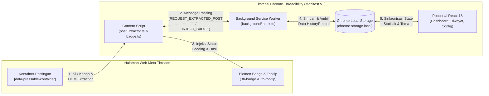
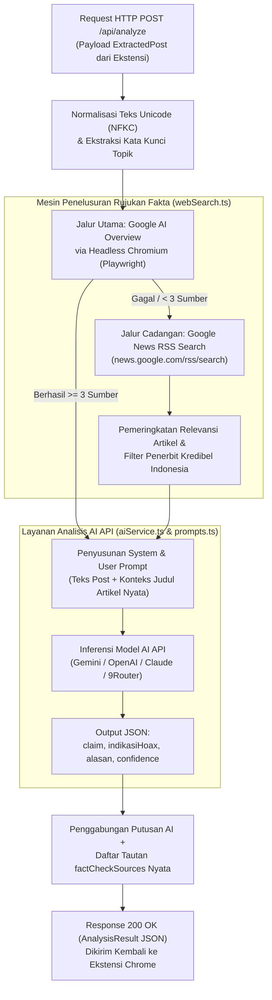
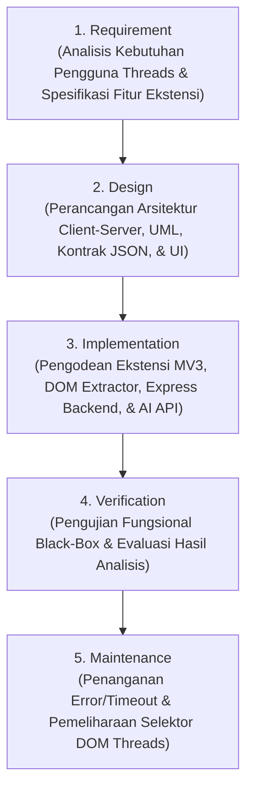

# BAB II
# TINJAUAN PUSTAKA

Bab ini menguraikan kajian penelitian terdahulu (*State of the Art*) serta landasan teori yang berkaitan langsung dengan aplikasi yang dibangun dalam penelitian ini, yaitu **Threadibility: Ekstensi Google Chrome untuk Deteksi Hoax Berbasis Teks pada Platform Threads**. Pembahasan difokuskan sepenuhnya pada konsep dan komponen teknologi yang diimplementasikan di dalam aplikasi, meliputi fenomena hoax pada platform Meta Threads, arsitektur ekstensi Google Chrome berbasis *Manifest V3* (*Background Service Worker*, *Content Script*, *DOM Extraction*, *Badge & Tooltip Injection*, dan *React Popup UI*), arsitektur server *backend* berbasis *Express.js REST API*, mekanisme penelusuran sumber rujukan berita/cek fakta otomatis (*Google AI Overview* via *Playwright* dan *Google News RSS*), integrasi layanan API Kecerdasan Buatan (*Google Gemini API* dan *Multi-Model LLM API*), serta metode pengembangan perangkat lunak *Waterfall*.

---

## 2.1 State of the Art

Bagian ini menyajikan tinjauan terhadap penelitian-penelitian terdahulu yang menjadi acuan dalam pengembangan aplikasi ekstensi Google Chrome untuk deteksi hoax pada platform Threads. Tinjauan ini bertujuan untuk mengidentifikasi pendekatan yang telah dilakukan sebelumnya serta menegaskan posisi dan keunggulan aplikasi yang dibangun pada penelitian ini.

### Review Artikel ke-1

| Komponen | Uraian |
| :--- | :--- |
| **Judul Artikel** | *Automated Fact-Checking to Support Professional Practices: Systematic Literature Review and Meta-Analysis* [2] |
| **Jurnal** | *International Journal of Communication* |
| **Volume / Edisi** | Vol. 17, pp. 5170–5190 |
| **Tahun Terbit** | 2023 |
| **Penulis / Author** | Laurence Dierickx, Carl-Gustav Lindén, Andreas Lothe Opdahl |
| **Masalah** | Penelitian ini mengidentifikasi bahwa meskipun sistem *automated fact-checking* (AFC) telah banyak dikembangkan, sebagian besar penelitian masih berfokus pada pengujian algoritma di belakang layar tanpa mengintegrasikan kemudahan akses dan kebutuhan pengguna akhir dalam proses pengembangannya. |
| **Solusi yang Diberikan** | Melakukan *systematic literature review* dan *meta-analysis* untuk memetakan pengembangan alat bantu verifikasi fakta otomatis serta menekankan pentingnya perancangan alat yang berorientasi pada pengguna (*user-centered*) dan menyajikan bukti rujukan yang transparan. |
| **Hasil Penelitian** | Lebih dari 80% penelitian AFC hanya berfokus pada eksperimen komputasi murni tanpa menghasilkan alat praktis yang langsung dapat digunakan oleh pengguna saat mengonsumsi informasi. Penelitian ini menyimpulkan perlunya alat bantu verifikasi yang mudah diakses, transparan dalam menampilkan sumber bukti, dan terintegrasi dengan aktivitas pengguna. |

**Kesimpulan Artikel ke-1:**
Artikel ini menunjukkan bahwa alat bantu verifikasi fakta otomatis harus dirancang agar mudah digunakan langsung oleh pengguna akhir dan transparan dalam menyajikan bukti verifikasi. Celah inilah yang dijawab oleh aplikasi **Threadibility**, di mana proses verifikasi dikemas menjadi ekstensi Google Chrome yang dapat dipicu cukup dengan klik kanan pada postingan Threads, lalu langsung menampilkan lencana (*badge*) status beserta kartu *tooltip* berisi alasan analisis dan tautan artikel rujukan cek fakta.

---

### Review Artikel ke-2

| Komponen | Uraian |
| :--- | :--- |
| **Judul Artikel** | *Browser Extension for Fake URL Detection* [3] |
| **Jurnal / Prosiding** | Department of Computer Science and Engineering, Government College of Engineering Nagpur, India |
| **Volume / Edisi** | - |
| **Tahun Terbit** | 2024 |
| **Penulis / Author** | Latesh G. Malik, Rohini Shambharkar, Shivam Morey, Shubhlak Kanpate, Vedika Raut |
| **Masalah** | Pengguna internet sering kali kesulitan mengidentifikasi konten berbahaya secara manual saat berselancar di web, sementara belum tersedia alat bantu praktis yang terintegrasi langsung ke dalam peramban (*browser*) untuk memberikan peringatan secara *real-time*. |
| **Solusi yang Diberikan** | Mengembangkan ekstensi browser dengan *frontend* berbasis HTML, CSS, dan JavaScript yang terhubung ke server *backend* melalui API untuk mendeteksi URL palsu (*phishing*) dan spam secara langsung pada saat pengguna menjelajahi web. |
| **Hasil Penelitian** | Pendekatan berbasis arsitektur *client-server* pada ekstensi browser terbukti efektif memberikan perlindungan dan informasi deteksi secara *real-time* kepada pengguna tanpa mengganggu aktivitas *browsing* mereka. |

**Kesimpulan Artikel ke-2:**
Artikel ini membuktikan efektivitas arsitektur ekstensi browser yang terhubung dengan server *backend* untuk melakukan deteksi konten secara *real-time*. Namun, aplikasi pada penelitian tersebut hanya mendeteksi URL berbahaya dan spam email. Penelitian ini mengadaptasi pendekatan ekstensi Google Chrome tersebut untuk objek yang berbeda, yaitu mengekstraksi dan mengidentifikasi konten post berbasis teks pada platform media sosial **Threads**.

---

### Review Artikel ke-3

| Komponen | Uraian |
| :--- | :--- |
| **Judul Artikel** | *Sistem Deteksi Berita Hoaks Berbasis Algoritma Natural Language Processing (NLP) Menggunakan BERT* [1] |
| **Jurnal** | *Jurnal Ilmu Komputer* |
| **Volume / Edisi** | Vol. 4, No. 1, pp. 1–12 |
| **Tahun Terbit** | 2025 |
| **Penulis / Author** | Azura Fardhina, Ramadhan Mustaqim Siregar, Mika Ria Wahy Br Sibarani, Irsya Chlara Br Ginting, Andre Pratama |
| **Masalah** | Penyebaran berita hoaks di ruang digital semakin masif dan memicu keresahan sosial, sementara masyarakat mengalami kesulitan dalam membedakan informasi yang benar dan hoaks secara cepat. |
| **Solusi yang Diberikan** | Melakukan klasifikasi berita hoaks berbahasa Indonesia pada dataset statis dari Kaggle (730 artikel) untuk menghasilkan prediksi klasifikasi disertai tingkat kepercayaan (*confidence level*). |
| **Hasil Penelitian** | Sistem mampu mengklasifikasikan teks hoaks dan non-hoaks dengan tingkat kepercayaan tertentu, namun pengujian masih dilakukan secara luring (*offline*) pada dataset statis dan belum terhubung ke sumber berita terkini maupun antarmuka media sosial. |

**Kesimpulan Artikel ke-3:**
Artikel ini menunjukkan pentingnya penyajian status klasifikasi hoax yang disertai tingkat kepercayaan (*confidence level*). Namun, sistem pada penelitian tersebut masih bersifat *offline* pada dataset lama dan tidak dapat memeriksa klaim berita terbaru yang sedang viral di media sosial. Penelitian ini mengatasi keterbatasan tersebut dengan membangun aplikasi **Threadibility** yang bekerja secara *real-time* pada halaman web Threads, menggunakan penelusuran berita aktual dari Google serta layanan AI API untuk menganalisis klaim dan menyertakan tautan sumber berita pembanding.

---

### Tabel 2.1 Rangkuman Perbandingan Penelitian Terdahulu dengan Aplikasi yang Dibangun

| No | Penulis & Tahun | Bentuk Sistem / Objek | Keterbatasan Penelitian Terdahulu | Keunggulan Aplikasi yang Dibangun (*Threadibility*) |
| :-: | :--- | :--- | :--- | :--- |
| 1 | **Dierickx dkk. (2023)** [2] | Kajian literatur sistem *Automated Fact-Checking* (AFC). | Baru berupa rekomendasi konseptual agar alat AFC terintegrasi dengan alur kerja pengguna akhir. | Diimplementasikan menjadi ekstensi Google Chrome interaktif dengan pemicu klik kanan (*context menu*), injeksi *badge* langsung di post Threads, dan *Popup Dashboard*. |
| 2 | **Malik dkk. (2024)** [3] | Ekstensi Browser untuk deteksi URL *phishing* dan spam email. | Tidak dirancang untuk mengekstrak struktur DOM postingan media sosial maupun menganalisis klaim teks. | Memiliki modul *DOM Extraction* khusus untuk struktur halaman web **Meta Threads** (`threads.com` / `threads.net`) guna mengekstrak teks post, *username*, waktu, dan URL. |
| 3 | **Fardhina dkk. (2025)** [1] | Pengujian klasifikasi teks berita hoaks secara *offline* pada dataset Kaggle. | Tidak terintegrasi ke browser pengguna, tidak dapat memverifikasi berita terbaru secara *real-time*, dan tidak menyertakan tautan artikel sumber cek fakta. | Terhubung ke server *backend* yang menelusuri artikel cek fakta nyata di Google (*Google AI Overview* & *Google News RSS*) dan menganalisis klaim melalui layanan AI API secara *real-time*. |

---

## 2.2 Hoax dan Verifikasi Informasi pada Platform Threads

### 2.2.1 Pengertian Hoax dan Disinformasi
**Hoax** (berita bohong) adalah informasi palsu atau klaim tidak benar yang direkayasa untuk menutupi fakta sebenarnya dan menyesatkan opini pembaca [1]. Dalam ekosistem media sosial, informasi yang menyesatkan terbagi menjadi **misinformasi** (informasi keliru yang dibagikan ulang oleh pengguna tanpa menyadari ketidakbenarannya) dan **disinformasi** (informasi palsu yang sengaja dibuat untuk menipu publik, seperti berita palsu, pencatutan nama tokoh/instansi, maupun tautan penipuan) [6]. Kecepatan penyebaran informasi di media sosial membuat proses verifikasi manual menjadi tidak efektif, karena pengguna harus menyalin teks dan mencari referensi sendiri di tab peramban lain [2].

### 2.2.2 Platform Media Sosial Meta Threads
**Meta Threads** adalah platform media sosial mikroblog berbasis teks yang dikembangkan oleh Meta Platforms dan dapat diakses melalui peramban web pada domain `https://www.threads.net` dan `https://www.threads.com` [7]. Berbeda dengan Instagram yang berfokus pada konten visual, Threads berfokus pada unggahan teks pendek (*post*) hingga 500 karakter yang memuat opini, berita, maupun klaim informasi publik.

Secara teknis, halaman web Threads merupakan aplikasi web dinamis (*Single Page Application*) berbasis React, di mana setiap postingan pada lini masa (*feed*) dirender ke dalam kontainer elemen HTML yang memuat empat komponen data utama:
1. **Teks Isi Postingan (*Post Body Text*)**: Narasi atau klaim teks yang ditulis oleh pengguna di dalam elemen `` atau `
`.
2. **Nama Pengguna (*Username*)**: Identitas akun pembuat post yang ditandai dengan tautan profil berformat `/@username`.
3. **Tautan Postingan (*Post URL*)**: Alamat unik (*permalink*) dari postingan tersebut yang memiliki pola jalur `/post/{id}`.
4. **Waktu Unggah (*Timestamp*)**: Informasi waktu pembuatan post yang tersimpan pada atribut elemen `<time datetime="...">`.

Karena antarmuka web Threads tidak memiliki fitur pemeriksaan fakta bawaan, keempat komponen elemen HTML tersebut menjadi target ekstraksi data pada aplikasi ekstensi Google Chrome yang dibangun.

### 2.2.3 Konsep Verifikasi Klaim Otomatis pada Aplikasi
Dalam aplikasi **Threadibility**, proses identifikasi post hoax dirancang agar memberikan informasi yang transparan dan edukatif bagi pengguna. Setiap post teks yang dianalisis menghasilkan lima komponen informasi verifikasi:
1. **Klaim Inti (`claim`)**: Ringkasan pernyataan faktual utama yang terkandung di dalam teks postingan Threads.
2. **Status Indikasi Hoax (`indikasiHoax`)**: Putusan klasifikasi apakah klaim pada postingan tersebut terindikasi hoax (`true` / berstatus **Hoax**) atau terverifikasi aman/valid (`false` / berstatus **Verified**).
3. **Tingkat Keyakinan (`confidence`)**: Nilai tingkat kepercayaan hasil analisis dalam skala desimal `0.0` hingga `1.0` yang ditampilkan kepada pengguna dalam bentuk persentase (`0%` – `100%`).
4. **Alasan Analisis (`alasan`)**: Penjelasan logis sebanyak 2–4 kalimat yang menguraikan mengapa klaim tersebut dinyatakan sebagai hoax atau terverifikasi benar berdasarkan fakta dan bukti berita yang ditemukan.
5. **Sumber Rujukan Cek Fakta (`factCheckSources`)**: Daftar artikel berita atau klarifikasi cek fakta nyata yang memuat judul artikel (`title`), nama media penerbit (`publisher`), label putusan (`verdict`), tanggal terbit (`reviewDate`), serta tautan asli (`sourceUrl`) yang dapat diklik oleh pengguna.

---

## 2.3 Ekstensi Google Chrome (Arsitektur Sisi Klien / *Client-Side*)

### 2.3.1 Pengertian Ekstensi Google Chrome dan Manifest V3
**Ekstensi Google Chrome** (*Chrome Extension*) adalah aplikasi perangkat lunak berbasis teknologi web (HTML, CSS, dan TypeScript/JavaScript) yang dipasang ke dalam peramban Google Chrome untuk menambahkan fitur baru dan berinteraksi langsung dengan halaman web yang sedang dibuka pengguna [3], [8].

Aplikasi **Threadibility** dibangun menggunakan standar arsitektur terbaru **Google Chrome Manifest V3** (`manifest_version: 3`). Dalam Manifest V3, konfigurasi ekstensi didefinisikan secara terpusat untuk mengatur izin akses (*permissions*: `contextMenus`, `storage`, `activeTab`) serta membatasi hak akses domain (*host permissions*) hanya pada situs `https://*.threads.com/*` dan `https://*.threads.net/*` demi menjaga keamanan dan privasi pengguna [8].

Sebagaimana ditunjukkan pada diagram di atas, sisi klien ekstensi **Threadibility** tersusun atas tiga modul utama yang saling berkomunikasi:

### 2.3.2 Background Service Worker dan Chrome Extension API
**Background Service Worker** (`src/background/index.ts`) adalah skrip latar belakang berbasis kejadian (*event-driven*) yang bertindak sebagai pengatur alur komunikasi utama di dalam ekstensi [8]. Pada aplikasi yang dibangun, *Service Worker* memanfaatkan empat API bawaan Google Chrome:

1. **Chrome Context Menus API (`chrome.contextMenus`)**: Digunakan untuk mendaftarkan menu klik kanan khusus bertuliskan **"Cek Keaslian Post Threads"** yang hanya muncul ketika pengguna melakukan klik kanan pada halaman web Threads.
2. **Chrome Tabs & Runtime Messaging API (`chrome.tabs.sendMessage`)**: Digunakan untuk mengirim perintah pengambilan data post (`REQUEST_EXTRACTED_POST`) ke *Content Script* serta mengirimkan kembali hasil analisis (`INJECT_BADGE` atau `ANALYSIS_ERROR`) ke tab Threads yang aktif.
3. **Chrome Action Badge API (`chrome.action`)**: Digunakan untuk mengubah teks dan warna indikator pada ikon ekstensi di bilah alat (*toolbar*) Chrome secara *real-time*, yaitu `...` (warna toska `#46eedd` saat proses analisis berlangsung), `HOAX` (warna merah `#ffb4ab` jika terindikasi hoax), `SAFE` (warna hijau `#42ee7f` jika terverifikasi), atau `ERR` (jika terjadi kegagalan koneksi).
4. **Chrome Storage API (`chrome.storage.local`)**: Penyimpanan lokal asinkron pada peramban yang digunakan untuk menyimpan seluruh riwayat hasil analisis (`HistoryRecord`) beserta preferensi tampilan pengguna (*Dark Mode* / *Light Mode*) agar data tetap tersimpan meskipun peramban ditutup.

### 2.3.3 Content Script, DOM Extraction, dan Injeksi Visual (*Badge & Tooltip*)
**Content Script** (`src/content/`) adalah skrip ekstensi yang berjalan langsung di dalam konteks halaman web Threads untuk membaca dan memanipulasi *Document Object Model* (DOM) halaman tersebut [8], [9]. Dalam aplikasi **Threadibility**, *Content Script* menjalankan dua mekanisme inti:

1. **Mekanisme *DOM Extraction* (`src/content/postExtractor.ts`)**:
   Saat pengguna melakukan klik kanan pada sebuah postingan Threads, *event listener* `contextmenu` menangkap elemen HTML target. Fungsi `findPostContainer()` menelusuri elemen induk menggunakan selektor `[data-pressable-container="true"]` (atau *fallback* pencarian kontainer yang memiliki ikon tombol *Like* dan *Reply*). Selanjutnya, fungsi `extractPostData()` mengekstrak teks isi postingan secara bersih (mengabaikan teks tombol aksi dan angka jumlah *like/reply*), mengambil `@username`, mengambil URL postingan (`/post/`), serta mengambil waktu unggahan (`<time>`).
2. **Mekanisme Injeksi *Badge* dan *Tooltip* Interaktif (`src/content/badge.ts` & `badge.css`)**:
   Tanpa perlu berpindah halaman, ekstensi memanipulasi DOM Threads untuk menyisipkan elemen visual tepat di sebelah nama akun pembuat postingan:
   - **Loading Badge**: Saat analisis dimulai, disuntikkan lencana `🔍 Menganalisis...` sebagai umpan balik instan (*instant visual feedback*) dilengkapi pengaman batas waktu (*timeout safeguard*).
   - **Result Badge (`Hoax` / `Verified`)**: Setelah respons diterima dari server, lencana *loading* digantikan dengan lencana merah bertuliskan **Hoax** (`.tb-badge-hoax`) atau lencana hijau bertuliskan **Verified** (`.tb-badge-verified`).
   - **Interactive Tooltip (`.tb-tooltip`)**: Kartu informasi melayang yang muncul ketika pengguna mengarahkan kursor (*hover*) ke atas lencana hasil. *Tooltip* ini menampilkan status putusan, persentase *Confidence* (`Math.round(confidence * 100)%`), paragraf alasan analisis, serta daftar tautan sumber rujukan cek fakta yang dapat diklik untuk membuka artikel berita asli di tab baru.

### 2.3.4 Antarmuka Popup Ekstensi (*React Popup UI*)
**Popup UI** (`src/popup/`) adalah jendela antarmuka yang terbuka saat pengguna mengklik ikon ekstensi **Threadibility** di sudut kanan atas browser Chrome. Antarmuka ini dibangun menggunakan pustaka **React 18** dan memiliki tiga halaman navigasi utama:
1. **Tab Dashboard**: Menampilkan empat kartu statistik ringkasan (*Total Dianalisis*, *Terindikasi Hoaks*, *Terverifikasi*, dan *Keyakinan Rata-rata* dalam persentase) serta daftar 3 analisis terbaru.
2. **Tab Riwayat (*History*)**: Menampilkan seluruh catatan riwayat postingan yang pernah dianalisis dalam bentuk daftar akordeon (*expandable item*) yang memuat detail teks post, klaim, alasan, dan tautan rujukan cek fakta.
3. **Tab Pengaturan (*Config*) & Tema**: Menyediakan fitur penghapusan riwayat penyimpanan lokal (*Clear History*) serta tombol pengubah tema tampilan gelap/terang (*Dark Mode / Light Mode*).

---

## 2.4 Server Backend, Penelusuran Sumber Fakta, dan Integrasi AI API (Arsitektur Sisi Server / *Server-Side*)

### 2.4.1 Arsitektur Server Backend dan REST API JSON
Untuk memproses teks postingan yang dikirim oleh ekstensi Chrome, aplikasi **Threadibility** menggunakan server *backend* berbasis **Node.js** dan kerangka kerja **Express.js** (`server/src/index.ts`). Komunikasi antara ekstensi dan server menggunakan protokol **REST (*Representational State Transfer*) API** dengan format pertukaran data **JSON (*JavaScript Object Notation*)** [10].

Ketika *Background Service Worker* mengirimkan permintaan `HTTP POST /api/analyze` yang berisi payload `ExtractedPost` (`text`, `username`, `postUrl`, `timestamp`), server melakukan normalisasi karakter Unicode (`NFKC`) untuk membersihkan huruf dekoratif atau simbol tidak standar, lalu menjalankan alur pencarian bukti berita dan analisis kecerdasan buatan.

### 2.4.2 Penelusuran Sumber Rujukan Cek Fakta Otomatis (*Web Search Fact Retrieval*)
Salah satu permasalahan utama jika hanya mengandalkan model AI secara langsung adalah risiko model mengarang tautan referensi fiktif (*halusinasi URL*) dan ketidaktahuan model terhadap berita terbaru. Untuk mengatasi hal tersebut, server *backend* **Threadibility** merancang modul penelusuran fakta nyata ke Google secara otomatis sebelum dan sesudah analisis AI dilakukan (`server/src/services/webSearch.ts` dan `googleAiOverview.ts`) melalui dua mekanisme berlapis:

1. **Jalur Utama: Ekstraksi *Google AI Overview* Menggunakan Playwright (`googleAiOverview.ts`)**:
   Server menjalankan peramban *Chromium* di latar belakang (*off-screen browser automation*) menggunakan pustaka **Playwright (`playwright-core`)** [11] untuk membuka halaman pencarian Google Indonesia (`https://www.google.com/search?hl=id&gl=id&q=...`). Skrip mengekstrak teks **Ringkasan AI (*Google AI Overview*)** beserta daftar artikel berita rujukan nyata (judul artikel `<h3>`, nama domain penerbit `<cite>`, dan tautan `<a href>`), lalu mengklasifikasikan label putusan sumber (`HOAKS / DISINFORMASI`, `KLARIFIKASI / BANTAHAN`, `CEK FAKTA`, atau `BERITA TERKAIT`).
2. **Jalur Cadangan (*Fallback*): *Google News RSS Search* dan Algoritma Pemeringkatan (`webSearch.ts`)**:
   Apabila *Google AI Overview* tidak tersedia pada topik yang dicari, sistem secara otomatis menyusun kueri pencarian berita formal (`"{topik inti} cek fakta"`, `"{topik inti} hoaks"`) dan memanggil endpoint sindikasi **Google News RSS Indonesia** (`https://news.google.com/rss/search?hl=id&gl=ID&ceid=ID:id`).
   Setiap artikel berita yang diperoleh dari XML RSS dihitung skor relevansinya berdasarkan:
   - Kecocokan kata kunci topik klaim pada judul berita (*Keyword Overlap*),
   - Bobot tambahan (+3 poin) jika judul memuat kata kunci pemeriksaan fakta (*hoaks, cek fakta, klarifikasi, bantah, disinformasi*),
   - Bobot tambahan (+2 poin) jika berasal dari media kredibel atau organisasi pemeriksa fakta di Indonesia (*TurnBackHoax/Mafindo, Kompas, Tempo, Antara, Detik, CNN Indonesia, Liputan6, Tirto*, atau situs resmi `.go.id`).

Dengan mekanisme ini, seluruh tautan rujukan (`factCheckSources`) yang ditampilkan pada *tooltip* ekstensi dijamin merupakan artikel berita nyata yang relevan dengan klaim yang sedang diperiksa.

### 2.4.3 Integrasi Layanan AI API (*Large Language Model API*) dan *Prompt Engineering*
Setelah daftar judul artikel rujukan dari Google diperoleh, server *backend* mengirimkan teks postingan beserta konteks berita tersebut ke layanan **AI API (*Large Language Model*)** melalui modul `server/src/services/aiService.ts` [12].

Aplikasi **Threadibility** mendukung integrasi layanan **Google Gemini API** (`gemini-1.5-flash` / `gemini-2.0-flash`) [13] sebagai mesin analisis utama, serta dilengkapi fitur **AI Research Lab & Benchmark Dashboard** (`http://localhost:5000`) yang juga mendukung **OpenAI API** (`gpt-4o-mini`), **Anthropic Claude API** (`claude-3-5-haiku`), dan **9Router API** untuk kebutuhan pengujian komparasi model dan ekspor log pengujian ke format CSV (`server/src/storage.ts`).

Pengendalian analisis AI dilakukan melalui teknik **Prompt Engineering** pada modul `server/src/prompts.ts` yang menerapkan aturan ketat sebagai berikut:
1. **Penetapan Peran (*System Prompt*)**: Menginstruksikan AI bertindak sebagai spesialis pemeriksa fakta (*Fact-Checking Specialist*) Indonesia yang mengevaluasi klaim secara objektif berdasarkan hasil penelusuran web dan regulasi yang berlaku.
2. **Aturan Putusan dan Pencegahan Tuduhan Palsu**:
   - Nilai `indikasiHoax: true` hanya diberikan apabila klaim terbukti bertentangan dengan fakta/regulasi resmi, dibantah oleh artikel cek fakta dalam hasil penelusuran, atau memiliki pola penipuan (*phishing* / hadiah fiktif).
   - Nilai `indikasiHoax: false` diberikan apabila klaim didukung oleh berita kredibel. Apabila suatu klaim merupakan kabar/rumor terkini yang belum memiliki bukti bantahan maupun konfirmasi resmi, AI diinstruksikan memilih `false` dengan nilai *confidence* rendah ($\le 0,60$) dan menjelaskan bahwa klaim tersebut belum terverifikasi.
3. **Skema Keluaran JSON Terstruktur**: Memastikan AI hanya mengembalikan objek JSON valid dengan atribut `claim`, `indikasiHoax`, `alasan`, dan `confidence`, yang kemudian digabungkan oleh server dengan daftar `factCheckSources` hasil penelusuran web.

---

## 2.5 Perangkat Lunak dan Teknologi Pembangunan Aplikasi

Dalam tahap implementasi kode program, aplikasi **Threadibility** dibangun menggunakan perangkat lunak dan pustaka pemrograman berikut:

1. **TypeScript**: Bahasa pemrograman berbasis JavaScript dengan sistem pengetikan data statis (*static typing*) [14]. TypeScript digunakan baik pada sisi ekstensi Chrome (`src/`) maupun sisi server *backend* (`server/src/`) untuk menjamin konsistensi kontrak tipe data (`ExtractedPost`, `AnalysisResult`, `FactCheckSource`, dan `HistoryRecord`).
2. **React 18 & CSS3**: Pustaka JavaScript untuk membangun antarmuka pengguna deklaratif berbasis komponen pada halaman *Popup* ekstensi (`Popup.tsx`, `StatsCard.tsx`, `HistoryItem.tsx`), dipadukan dengan CSS variabel modern untuk mendukung tema *Dark/Light Mode* dan desain *tooltip* di halaman Threads.
3. **Vite & `@crxjs/vite-plugin`**: *Build tool* dan pemaket modul (*bundler*) modern yang digunakan untuk mengompilasi kode TypeScript dan React menjadi paket distribusi ekstensi Chrome Manifest V3 siap pakai di dalam direktori `dist/`.
4. **Node.js, Express.js, & Playwright Core**: Lingkungan eksekusi sisi server yang digunakan untuk menjalankan layanan REST API (`POST /api/analyze` dan `POST /api/compare`), mengelola penyimpanan riwayat pengujian JSON/CSV, serta menjalankan otomasi ekstraksi pencarian Google.

---

## 2.6 Metode Penelitian dan Pembangunan Perangkat Lunak

### 2.6.1 Metode Pengumpulan Data (Studi Literatur dan Survei Kuesioner)
Penelitian ini menggunakan pendekatan kualitatif deskriptif dengan mengumpulkan data melalui studi literatur dan penyebaran kuesioner kepada pengguna aktif platform Threads [15]. Kuesioner digunakan untuk mengidentifikasi tingkat kesulitan pengguna dalam memverifikasi informasi secara manual serta merumuskan kebutuhan fitur ekstensi. Analisis data kuesioner dihitung menggunakan rumus distribusi persentase deskriptif:

$$P = \frac{f}{N} \times 100\%$$

di mana $P$ adalah persentase jawaban responden, $f$ adalah frekuensi jawaban terpilih, dan $N$ adalah jumlah total responden.

### 2.6.2 Metode Pembangunan Perangkat Lunak *Waterfall*
Pengembangan aplikasi ekstensi Google Chrome dan server *backend* pada penelitian ini mengikuti tahapan metode **Waterfall** menurut Sommerville [16] yang berjalan secara sistematis dan berurutan:

1. **Requirement**: Mendeskripsikan kebutuhan fungsional pengguna (pemicu klik kanan di Threads, indikator *badge* langsung di postingan, *tooltip* penjelasan beserta link sumber fakta, dan *popup* riwayat) berdasarkan hasil survei dan studi literatur.
2. **Design**: Merancang arsitektur komunikasi antara *Content Script*, *Background Service Worker*, dan *Express Backend*, memodelkan diagram UML (*Use Case*, *Activity*, dan *Sequence Diagram*), serta merancang tampilan *badge*, *tooltip*, dan *Popup UI*.
3. **Implementation**: Membangun kode program ekstensi Google Chrome Manifest V3 (`src/`) dan server *backend* (`server/src/`) menggunakan TypeScript, React, Vite, Express.js, Playwright, serta integrasi AI API.
4. **Verification**: Melakukan pengujian fungsional (*Black-Box Testing*) terhadap seluruh fitur ekstensi pada halaman web Threads serta menguji ketepatan respons analisis hoax, alasan, skor *confidence*, dan tautan rujukan.
5. **Maintenance**: Melakukan perbaikan apabila terjadi perubahan selektor DOM pada pembaruan situs Threads serta menjaga keandalan penanganan batas waktu (*timeout safeguard*).

### 2.6.3 Alat Bantu Pemodelan Sistem (UML) dan Pengujian *Black-Box*
Dalam tahap perancangan (*Design*), pemodelan visual aplikasi menggunakan **Unified Modeling Language (UML)** yang meliputi **Use Case Diagram** (memodelkan interaksi pengguna dengan fitur ekstensi), **Activity Diagram** (memodelkan alur proses dari klik kanan hingga tampilnya *badge*), serta **Sequence Diagram** (memodelkan urutan pertukaran pesan antara DOM halaman Threads, *Content Script*, *Service Worker*, *Backend API*, mesin penelusuran Google, dan layanan AI API) [17].

Selanjutnya, pada tahap *Verification*, dilakukan pengujian menggunakan metode **Black-Box Testing**, yaitu pengujian perangkat lunak yang menitikberatkan pada validasi fungsi masukan (*input*) dan keluaran (*output*) antarmuka aplikasi tanpa menguji kode internal layanan pihak ketiga [17]. Pengujian mencakup skenario ekstraksi berbagai post teks di halaman web Threads, penyuntikan *badge* dan *tooltip*, pembukaan tautan sumber rujukan, hingga pengelolaan riwayat pada *Popup Dashboard*.

---

## DAFTAR PUSTAKA (Format IEEE Sesuai Standar UNIKOM)

[1] A. Fardhina, R. M. Siregar, M. R. W. Br Sibarani, I. C. Br Ginting, and A. Pratama, "Sistem Deteksi Berita Hoaks Berbasis Algoritma Natural Language Processing (NLP) Menggunakan BERT," *Jurnal Ilmu Komputer*, vol. 4, no. 1, pp. 1–12, 2025.

[2] L. Dierickx, C. G. Lindén, and A. L. Opdahl, "Automated Fact-Checking to Support Professional Practices: Systematic Literature Review and Meta-Analysis," *International Journal of Communication*, vol. 17, pp. 5170–5190, 2023.

[3] L. G. Malik, R. Shambharkar, S. Morey, S. Kanpate, and V. Raut, "Browser Extension for Fake URL Detection," Department of Computer Science and Engineering, Government College of Engineering Nagpur, India, 2024.

[4] Y. Widhiyasana, T. Semiawan, I. G. A. Mudzakir, and M. R. Noor, "Penerapan Convolutional Long Short-Term Memory untuk Klasifikasi Teks Berita Bahasa Indonesia," *Jurnal Nasional Teknik Elektro dan Teknologi Informasi*, vol. 10, no. 4, pp. 354–362, Nov. 2021.

[5] L. Dierickx, C. G. Lindén, and A. L. Opdahl, "Automated Fact-Checking to Support Professional Practices," *International Journal of Communication*, vol. 17, pp. 5172–5184, 2023.

[6] C. Wardle and H. Derakhshan, "Information Disorder: Toward an Interdisciplinary Framework for Research and Policy Making," Council of Europe, Report DGI(2017)09, 2017.

[7] Meta Platforms, Inc., "Introducing Threads: A New Way to Share With Text," *Meta Newsroom*, Jul. 2023. [Online]. Available: https://about.fb.com/news/2023/07/introducing-threads-new-app-text-sharing/

[8] Google Chrome Developers, "Chrome Extensions Manifest V3 Overview and Architecture," Google LLC, 2024. [Online]. Available: https://developer.chrome.com/docs/extensions/develop/migrate/what-is-mv3

[9] World Wide Web Consortium (W3C), "DOM Living Standard — Document Object Model," WHATWG/W3C, 2024. [Online]. Available: https://dom.spec.whatwg.org/

[10] M. Masse, *REST API Design Rulebook: Designing Consistent RESTful Web Service Interfaces*. Sebastopol, CA, USA: O'Reilly Media, 2011.

[11] Microsoft Corporation, "Playwright Documentation: Fast and Reliable End-to-End Testing and Browser Automation," 2024. [Online]. Available: https://playwright.dev/docs/intro

[12] D. Quelle and A. Bovet, "The perils and promises of fact-checking with large language models," *Frontiers in Artificial Intelligence*, vol. 7, Art. no. 1341697, 2024.

[13] Google AI for Developers, "Gemini API Overview and Documentation," Google LLC, 2024. [Online]. Available: https://ai.google.dev/gemini-api/docs

[14] Microsoft Corporation, "TypeScript Language Handbook," 2024. [Online]. Available: https://www.typescriptlang.org/docs/

[15] J. W. Creswell and J. D. Creswell, *Research Design: Qualitative, Quantitative, and Mixed Methods Approaches*, 6th ed. Thousand Oaks, CA, USA: SAGE Publications, 2022.

[16] I. Sommerville, *Software Engineering*, 10th ed. Boston, MA, USA: Pearson Education, 2016.

[17] R. S. Pressman and B. R. Maxim, *Software Engineering: A Practitioner's Approach*, 9th ed. New York, NY, USA: McGraw-Hill Education, 2020.
