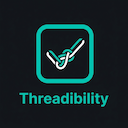
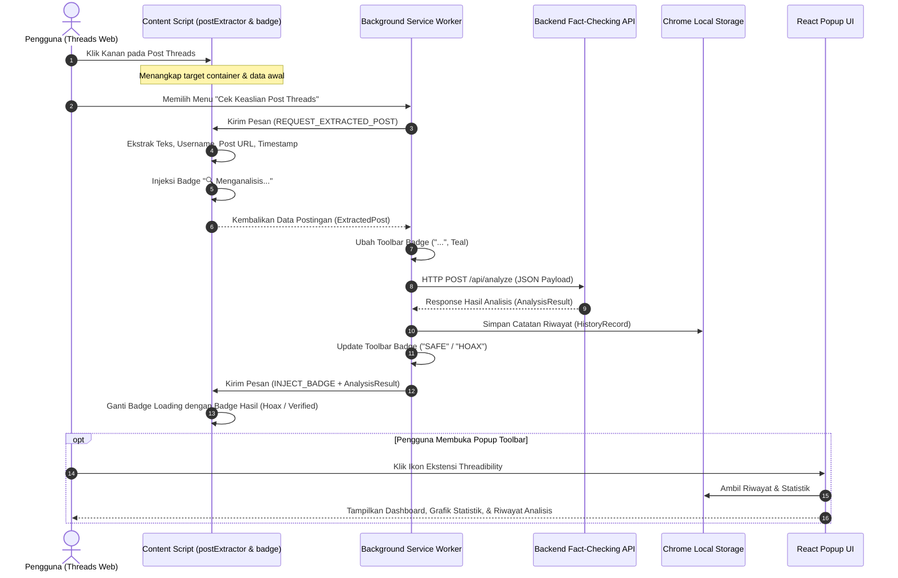

# 🧵 Threadibility — Threads Hoax & Credibility Identifier Extension

<div align="center">



**Ekstensi Google Chrome (Manifest V3) untuk Deteksi Hoaks dan Verifikasi Kredibilitas Konten Teks pada Platform Meta Threads Secara Real-Time.**

*Proyek Skripsi / Tugas Akhir*

[](https://www.typescriptlang.org/)
[](https://reactjs.org/)
[](https://vitejs.dev/)
[](https://developer.chrome.com/docs/extensions/mv3/intro/)
[](LICENSE)

</div>

---

## 📌 Daftar Isi
1. [Tentang Proyek](#-tentang-proyek)
2. [Fitur Utama](#-fitur-utama)
3. [Arsitektur & Alur Kerja Sistem](#-arsitektur--alur-kerja-sistem)
4. [Struktur Folder](#-struktur-folder)
5. [Spesifikasi Kontrak Data (API Schema)](#-spesifikasi-kontrak-data-api-schema)
6. [Prasyarat Sistem](#-prasyarat-sistem)
7. [Panduan Instalasi & Menjalankan](#-panduan-instalasi--menjalankan)
   - [1. Clone & Install Dependencies](#1-clone--install-dependencies)
   - [2. Konfigurasi Environment](#2-konfigurasi-environment)
   - [3. Kompilasi / Build Ekstensi](#3-kompilasi--build-ekstensi)
   - [4. Pemasangan Ekstensi ke Google Chrome](#4-pemasangan-ekstensi-ke-google-chrome)
8. [Panduan Penggunaan](#-panduan-penggunaan)
9. [Tech Stack](#-tech-stack)
10. [Lisensi & Penulis](#-lisensi--penulis)

---

## 📖 Tentang Proyek

**Threadibility** adalah ekstensi peramban (*browser extension*) berbasis **Google Chrome Manifest V3** yang dikembangkan sebagai bagian dari penelitian skripsi/tugas akhir. Ekstensi ini mempermudah pengguna dalam memverifikasi kebenaran dan mendeteksi potensi disinformasi/hoaks pada postingan platform media sosial **Meta Threads** (`threads.com` / `threads.net`) secara langsung di antarmuka web.

Dengan memanfaatkan integrasi menu klik kanan (*context menu*), scraping DOM cerdas (*intelligent DOM parser*), dan integrasi API Fact-Checking berbasis Machine Learning/NLP, Threadibility memberikan penilaian instan berupa badge status keaslian (*Verified* atau *Hoax*), tingkat keyakinan (*confidence rate*), ringkasan analisis, serta tautan ke sumber cek fakta terpercaya.

---

## ✨ Fitur Utama

- 🖱️ **Pemicu Context Menu Cepat**: Cukup klik kanan pada area postingan Threads dan pilih *"Cek Keaslian Post Threads"*.
- ⚡ **Scraping DOM Cerdas & Adaptif**: Mengekstrak teks postingan secara akurat, nama akun pembuat (*username*), tautan unik postingan (*post URL*), dan waktu unggah postingan (*timestamp*).
- 🔄 **Indikator Visual Real-Time (Instant Feedback)**:
  - Menyuntikkan badge `🔍 Menganalisis...` seketika saat diklik untuk mencegah kebingungan pengguna.
  - Toolbar Action Badge Chrome berubah dinamis: `...` *(Loading)*, `SAFE` *(Terverifikasi)*, `HOAX` *(Terindikasi Hoax)*, atau `ERR` *(Error)*.
- 🏷️ **Injeksi Badge Status & Tooltip Interaktif**:
  - Badge `Verified` (Hijau) atau `Hoax` (Merah muda) disematkan langsung di samping username Threads.
  - Hovering pada badge menampilkan kartu tooltip rincian klaim, persentase keyakinan, argumen verifikasi, dan tautan rujukan artikel cek fakta eksternal.
- 📊 **Popup Dashboard & Statistik Lengkap**:
  - Statistik agregat: *Total Analyzed*, *Hoax Detected*, *Verified True*, dan *Accuracy Rate*.
  - Riwayat pengecekan tersimpan aman di `chrome.storage.local`.
  - Panel rincian histori berbentuk akordeon (*expandable item*).
- 🌓 **Tema Gelap & Terang (Dark / Light Mode)**: Antarmuka popup mendukung pergantian mode warna yang disinkronkan ke penyimpanan lokal.
- 🛡️ **Pencegahan Memory Leak & Timeout Safeguard**: Mekanisme pembatalan timer otomatis (*clearTimeout*) dan penanganan fallback saat koneksi backend mengalami kendala.

---

## 🧠 Arsitektur & Alur Kerja Sistem

Berikut adalah diagram alir proses analisis dari interaksi pengguna hingga penyajian hasil verifikasi:



### Penjelasan Komponen:
1. **Content Script (`src/content/`)**:
   - `postExtractor.ts`: Melakukan traversal pohon DOM Threads (`[data-pressable-container="true"]` atau fallback SVG selector) dan mengekstrak komponen postingan secara higienis (menghapus tombol aksi dan teks metadata yang tidak relevan).
   - `badge.ts`: Memanipulasi DOM untuk menyuntikkan badge status dan tooltip informatif.
   - `index.ts`: Koordinator event listener klik kanan dan message router antara halaman web dan service worker.
2. **Background Service Worker (`src/background/index.ts`)**:
   - Mengelola lifecycle *Context Menu* Chrome.
   - Mengirimkan permintaan HTTP asinkron ke server backend AI/NLP.
   - Mengontrol indikator visual ikon toolbar browser.
   - Menyimpan seluruh transaksi hasil analisis ke `chrome.storage.local`.
3. **Popup Interface (`src/popup/`)**:
   - Antarmuka React 18 dengan komponen modern untuk memantau performa deteksi, melihat rincian arsip cek fakta, mengatur tema, dan mengelola data riwayat.

---

## 📁 Struktur Folder

```text
Threadibility/
├── .env.development           # Variabel lingkungan untuk server lokal (http://localhost:5000/api/analyze)
├── .env.production            # Variabel lingkungan untuk server produksi publik
├── .env.example               # Template variabel lingkungan
├── .gitignore                 # Konfigurasi file yang diabaikan Git (node_modules, dist, .env)
├── package.json               # Konfigurasi dependensi Node.js & skrip kompilasi
├── tsconfig.json              # Konfigurasi compiler TypeScript (Strict Mode)
├── vite.config.ts             # Konfigurasi bundler Vite + @crxjs/vite-plugin
├── full_audit_report.md       # Laporan audit teknis dan kesiapan sistem lengkap
├── public/
│   └── threadibility.png      # Aset ikon ekstensi (128x128 px)
├── dist/                      # [Generated] Direktori hasil kompilasi untuk dimuat di browser
├── server/                    # 🚀 [Backend & Dashboard Lab Riset AI Skripsi]
│   ├── package.json           # Dependensi Express + TypeScript + tsx
│   ├── public/                # Antarmuka Dashboard Web (http://localhost:5000)
│   │   ├── index.html         # Form 3 Token AI, Model Switcher, Benchmark Playground
│   │   ├── style.css          # Desain Modern Dark Mode + Glassmorphism
│   │   └── app.js             # Client Script untuk API call & live sync
│   └── src/
│       ├── index.ts           # Express REST API (POST /api/analyze, /api/compare, dll)
│       ├── config.ts          # Penyimpan & penyamar (masking) API Key lokal
│       ├── storage.ts         # Riwayat analisis, metrik latensi, & export CSV
│       ├── prompts.ts         # Prompting spesialis Fact-Checking Indonesia
│       └── services/          # Integrasi OpenAI (GPT), Gemini, & Claude 3.5
└── src/
    ├── manifest.config.ts     # Konfigurasi skema Manifest V3 Chrome Extension
    ├── vite-env.d.ts          # Definisi tipe client Vite
    ├── background/
    │   └── index.ts           # Background Service Worker (Context Menu, API Fetch, Storage)
    ├── content/
    │   ├── index.ts           # Listener pesan & orkestrator content script
    │   ├── postExtractor.ts   # Algoritma ekstraksi teks dan metadata postingan Threads
    │   ├── badge.ts           # Modul injeksi elemen badge & tooltip ke DOM
    │   └── badge.css          # Styling CSS murni untuk badge & tooltip
    ├── popup/
    │   ├── index.html         # Template HTML container popup
    │   ├── main.tsx           # Entry point aplikasi React popup
    │   ├── Popup.tsx          # Komponen utama popup (Tab Dashboard, History, Config)
    │   ├── StatsCard.tsx      # Komponen kartu statistik dengan efek 3D Tilt
    │   ├── HistoryItem.tsx    # Komponen item riwayat dengan panel rujukan fakta
    │   └── popup.css          # Desain visual popup (Dark/Light mode & custom scrollbar)
    └── shared/
        └── types.ts           # Kontrak antarmuka TypeScript terpusat
```

---

## 📡 Spesifikasi Kontrak Data (API Schema)

Ekstensi berkomunikasi dengan backend melalui REST API JSON.

### 1. Request Payload (`POST` ke `VITE_BACKEND_URL`)
```json
{
  "text": "Teks lengkap isi postingan Threads yang akan dianalisis...",
  "username": "@username_pembuat",
  "postUrl": "https://www.threads.net/@username_pembuat/post/XXXXXXXX",
  "timestamp": "2026-08-30T05:00:00.000Z"
}
```

### 2. Response Payload dari Backend
```json
{
  "claim": "Pernyataan inti / klaim utama yang diekstraksi dari postingan",
  "indikasiHoax": true,
  "alasan": "Penjelasan rinci mengapa informasi pada postingan ini dinyatakan tidak valid atau hoaks berdasarkan bukti cek fakta.",
  "confidence": 0.94,
  "factCheckSources": [
    {
      "publisher": "TurnBackHoax / Mafindo",
      "verdict": "Salah / Disinformasi",
      "reviewDate": "2026-08-25",
      "sourceUrl": "https://turnbackhoax.id/contoh-artikel-cek-fakta"
    }
  ]
}
```

---

## 💻 Prasyarat Sistem

Sebelum menjalankan proyek ini, pastikan sistem Anda telah terpasang:
- **Node.js**: Versi `18.x` atau lebih baru ([Unduh Node.js](https://nodejs.org/))
- **NPM**: Versi `9.x` atau lebih baru
- **Google Chrome / Chromium-based Browser** (Brave, Microsoft Edge, Opera, dll.)
- **Git** ([Unduh Git](https://git-scm.com/))

---

## 🚀 Panduan Instalasi & Menjalankan

### 1. Clone & Install Dependencies

Clone repositori ini dan masuk ke direktori proyek:
```bash
git clone https://github.com/ranggalabs/Threadibility.git
cd Threadibility
```

Install seluruh dependensi proyek menggunakan `npm`:
```bash
npm install
```

---

### 2. Konfigurasi Environment

Salin file `.env.example` menjadi `.env.development` (untuk pengujian lokal) atau `.env.production` (untuk server live):

```bash
# Windows PowerShell
copy .env.example .env.development
```

Buka `.env.development` dan sesuaikan endpoint URL backend Anda:
```env
VITE_BACKEND_URL=http://localhost:5000/api/analyze
```

---

### 3. Kompilasi / Build Ekstensi

Jalankan skrip build untuk menghasilkan bundel ekstensi Chrome di folder `dist/`:

- **Mode Development (dengan source map):**
  ```bash
  npm run build:dev
  ```
- **Mode Produksi:**
  ```bash
  npm run build
  ```

Setelah proses selesai, direktori `dist/` akan terbentuk dengan struktur berkas Manifest V3 yang siap digunakan.

---

### 4. Pemasangan Ekstensi ke Google Chrome

1. Buka peramban **Google Chrome**.
2. Masuk ke halaman pengelolaan ekstensi dengan mengetikkan `chrome://extensions/` pada bilah alamat URL.
3. Aktifkan **Developer mode** (Mode pengembang) melalui *toggle switch* di pojok kanan atas.
4. Klik tombol **Load unpacked** (Muat yang belum dibongkar) di pojok kiri atas.
5. Pilih folder **`dist`** yang berada di dalam direktori proyek `Threadibility`.
6. Ekstensi **Threadibility** kini telah aktif dan terpasang pada browser Anda.

---

### 5. Menjalankan Backend & Dashboard Riset AI (Port 5000)

Jalankan server backend Express + TypeScript:
```bash
# Dari root direktori Threadibility:
npm run server
```

Server backend akan berjalan di **`http://localhost:5000`**.
1. Buka browser dan akses **`http://localhost:5000`** untuk membuka **AI Research Lab & Benchmark Dashboard**.
2. Masukkan 3 Token API Anda:
   - **OpenAI API Key** (`gpt-4o-mini` / `gpt-4o`)
   - **Google Gemini API Key** (`gemini-1.5-flash` / `gemini-2.0-flash`)
   - **Anthropic Claude API Key** (`claude-3-5-haiku` / `claude-3-5-sonnet`)
3. Pilih **Model Aktif** yang akan melayani permintaan ekstensi Chrome.
4. Klik **💾 Simpan Konfigurasi**.
5. Gunakan fitur **🧪 Uji Coba & Komparasi 3 Model AI Sekaligus** untuk membandingkan performa ketiga model secara berdampingan (*side-by-side*) lengkap dengan latensi (ms), tingkat keyakinan, dan ekspor dataset ke format CSV untuk analisis skripsi.

---

## 🎯 Panduan Penggunaan

1. Buka situs [Meta Threads](https://www.threads.net/) atau [Threads.com](https://www.threads.com/).
2. Cari postingan berbasis teks yang ingin Anda verifikasi kebenarannya.
3. **Klik kanan** pada postingan tersebut, lalu klik opsi menu **"Cek Keaslian Post Threads"**.
4. Amati respon ekstensi:
   - Badge loading `🔍 Menganalisis...` akan muncul di samping nama akun pembuat.
   - Ikon toolbar ekstensi akan menampilkan status `...`.
5. Setelah backend selesai menganalisis:
   - Badge akan berubah menjadi **`Verified`** (Hijau) atau **`Hoax`** (Merah muda).
   - Arahkan kursor (*hover*) ke badge tersebut untuk membaca rincian alasan dan melihat tautan sumber cek fakta.
6. Klik ikon ekstensi di toolbar pojok kanan atas browser untuk membuka **Dashboard Pop-up** dan melihat ringkasan statistik serta riwayat analisis yang pernah dilakukan.

---

## 🛠️ Tech Stack

| Komponen | Teknologi | Keterangan |
|---|---|---|
| **Language** | [TypeScript](https://www.typescriptlang.org/) `5.2+` | Bahasa pemrograman bertipe ketat untuk keandalan kode |
| **Framework UI** | [React](https://react.org/) `18.3+` | Antarmuka pengguna pada halaman Pop-up Ekstensi |
| **Bundler** | [Vite](https://vitejs.dev/) `5.3+` | Tooling & bundler performa tinggi |
| **Extension Plugin** | [@crxjs/vite-plugin](https://crxjs.dev/vite-plugin) `2.0-beta` | Integrasi otomatis bundel Chrome Extension Manifest V3 |
| **Platform Target** | Google Chrome Extension MV3 | Arsitektur modern Chrome Service Worker |
| **Styling** | Custom Pure CSS & Modern CSS Variables | Desain responsif, clean dark/light mode, & animasi |

---

## 📄 Lisensi & Penulis

Proyek ini dikembangkan untuk keperluan akademik dan penelitian skripsi.

- **Penulis**: Rangga Prasetya ([@ranggalabs](https://github.com/ranggalabs))
- **Lisensi**: [MIT License](LICENSE)
